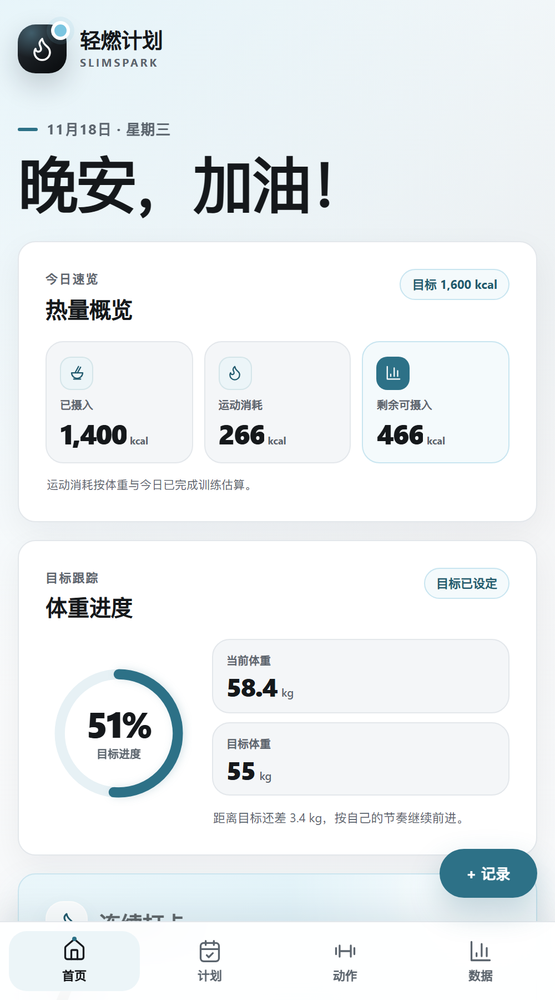
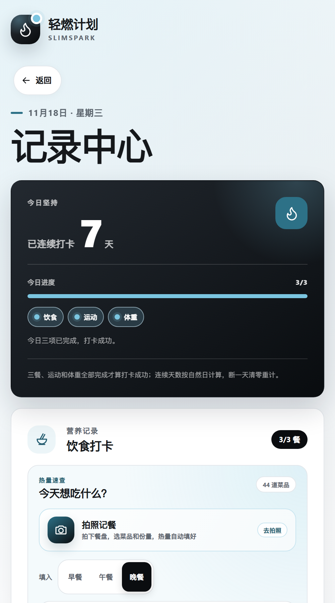
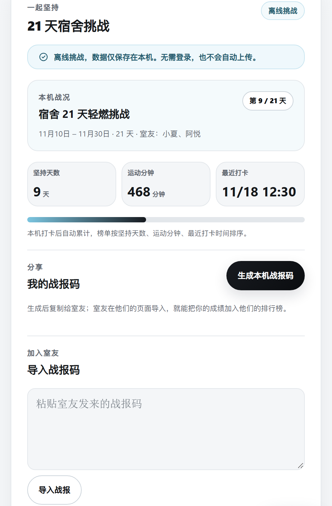
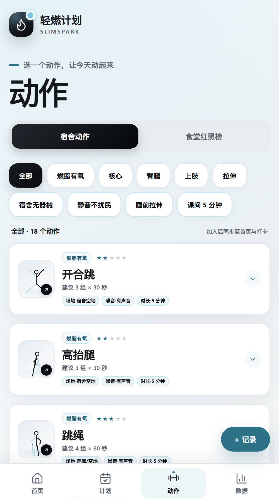

<div align="center">

# SlimSpark (轻燃计划)

**Make weight change part of a sustainable routine.**

A local-first, campus-oriented weight management and habit tracker built as a single-page app. Core records need no account and stay in your browser; AI photo recognition is optional.

[Full demo (AI enabled)](https://slimspark-3tunwyl4sfw.qoder.zone/) · [GitHub Pages static version](https://flow89930-source.github.io/slimspark/) · [简体中文](README.md)

[](https://slimspark-3tunwyl4sfw.qoder.zone/)
[](https://flow89930-source.github.io/slimspark/)
[](https://github.com/flow89930-source/slimspark)
[](https://github.com/flow89930-source/slimspark)
[](LICENSE)

</div>

| Home | Record center |
|:---:|:---:|
|  |  |

| Data: 21-day dorm challenge | Exercise library |
|:---:|:---:|
|  |  |

## Overview

SlimSpark brings goal planning, schedule-aware training, food/exercise/weight logging, body measurements, and challenge review into one mobile-first interface.

- **Local-first**: no account, cloud sync, analytics, or advertising. Profile, weight, meals, workouts, and check-ins stay in the current browser's `localStorage` by default.
- **Dual-direction planning**: supports both weight loss and weight gain. If a user with an underweight BMI sets a loss target, the app warns against further loss and guides them toward a healthy gain plan.
- **Built for campus life**: weekly class schedules, five-minute recess workouts, quiet dorm sessions, canteen ordering tips, and manageable training plans.
- **Optional AI**: a compressed meal photo is sent only after the user clicks “AI 识别”. If recognition fails, the app falls back to the local dish library without blocking manual logging.
- **Zero build**: plain HTML, CSS, and JavaScript. Clone, serve, and use. Charts load from a CDN.

> BMI, BMR, TDEE, calorie targets, and training suggestions are general estimates, not medical advice. Consult a doctor or registered dietitian for individual guidance.

## Features

### Planning and schedules

- Collects sex, age, height, current weight, target weight, weekly exercise days, and desired timeframe.
- Calculates BMI, basal metabolic rate (BMR), total daily energy expenditure (TDEE), and a daily calorie target.
- Builds a 4-, 8-, or 12-week plan and warns when the requested loss or gain pace exceeds common healthy guidance.
- The gain path includes a calorie surplus, protein guidance, strength-training suggestions, and a sample gain-focused day of meals.
- Lets users mark each weekday as class day or free day with available training time, then generates a week of workouts, micro-sessions, and rest days.
- Supports exercise swaps, carrying missed work forward, rescheduling within the week, and skipping; skipping changes the schedule without breaking the check-in streak.

### Dashboard and logging

- Today's calorie overview: intake, exercise burn, and remaining calories, each linked to its record screen.
- Weight-goal progress, current streak, and today's task completion at a glance.
- Campus micro-workouts: a five-minute recess session and a quiet dorm fat-burn session, automatically written to the day's exercise log when finished.
- Food logging for breakfast, lunch, dinner, and snacks, with food names and calories.
- Workout check-ins with selectable exercises, duration, and editable custom items.
- Weight entries feed the home progress view and the trend chart on the data page.
- Status feedback and a celebration animation after completing check-ins.

### Photo meals and optional AI

- Photos are compressed locally to at most 720px on the long edge and about 80KB, then kept for the latest seven days.
- A compressed photo is uploaded only when the user clicks “AI 识别”; ordinary photo logging stays local.
- Recognition results are matched against the local dish library; low-confidence results prompt the user to choose manually.
- Missing backend, offline mode, timeout, or request failure produces a clear message and a manual-search fallback, never a blank screen.

### Food, canteen, and exercise libraries

- 44 common dishes across seven categories with calorie references, name/alias search, and per-meal quick presets.
- 30 canteen ordering references with calories, pairing suggestions, and lighter swaps.
- 18 exercises covering cardio, core, glutes and legs, upper body, and stretching.
- Expandable exercise cards with steps, breathing cues, common mistakes, and a shortcut to add the move to today's workout.
- Filters for dorm-friendly, quiet, bedtime, and five-minute sessions, plus local recommendations and exercise swaps.

### Progress, challenges, and badges

- Weight trend line chart with the target weight marked.
- 12-week check-in heatmap showing completed and active days.
- Seven-day intake-versus-target calorie bar chart.
- Body measurements for waist, hip, and thigh, with dated entries and a trend chart.
- 21-day dorm challenge: set a name, start date, and up to four roommate nicknames; local check-ins automatically accumulate days and exercise minutes.
- Report codes are generated as JSON → Base64 for copying to roommates and importing into their leaderboard. Invalid codes show “格式不对，请重新复制” without crashing.
- Five badges: Canteen Specialist, Breakfast Hero, Quiet Grinder, Recess Hunter, and 21-Day Consistency. Conditions are computed from local records; tapping a badge shows its condition and current progress.
- When Chart.js fails to load, text summaries and actionable empty states replace blank charts.

### Mobile and accessibility

- Four equal-width bottom tabs: Home, Plan, Exercise, Data. The record center opens from its own entry point.
- 16px card radii, spacing based on multiples of 8, and `safe-area-inset-bottom` support.
- No horizontal overflow at 375 / 390 / 430px; tables become cards on narrow screens, and tap targets are at least 44px.
- Dialogs close with Esc and return focus to the trigger; a skip link and visible focus styles are included.
- Respects `prefers-reduced-motion`; imagery is inline SVG or lazily loaded, and the first screen does not depend on chart execution.

## Tech stack

| Layer | Choice |
| --- | --- |
| UI | HTML5 + CSS3 (custom properties, Grid, Flexbox, media queries) |
| Logic | Vanilla JavaScript (ES6) |
| Charts | Chart.js 4.4.7 via jsDelivr CDN, loaded asynchronously |
| Storage | Browser `localStorage` |
| Motion | CSS animations + Intersection Observer |
| Optional AI backend | Deno + Qoder Sites Functions |
| Server data | PostgreSQL (rate-limiting and recognition cache) |
| Tests | Node.js built-in `node:test` |
| Static hosting | GitHub Pages (`main` branch, repository root) |

The static app has no frontend framework, package manager, or bundler. `functions/` is optional server-side AI code and is not used by GitHub Pages.

## Project structure

```text
.
├── index.html                  # SPA entry point and all page markup
├── favicon.svg                 # Site icon
├── css/
│   └── style.css               # Design system, responsive layout, and motion
├── js/
│   ├── app.js                  # Planning, check-ins, charts, challenge, and interactions
│   ├── data.js                 # Dish, canteen, and exercise data
│   └── motion.js               # Scroll reveals and celebration animation
├── functions/
│   ├── index.ts                # Optional Qoder Sites Functions entry
│   └── routes.mjs              # Optional AI routes, rate limits, and cache
├── db/
│   └── schema.sql              # Optional AI usage and cache tables
├── tests/
│   └── meal-ai-routes.test.mjs # Optional backend route tests
├── docs/screenshots/           # README screenshots
├── LICENSE                     # MIT License
├── README.md                   # Chinese README
└── README.en.md                # This file
```

## Run locally

Use a local static server rather than opening the HTML file directly:

```bash
git clone https://github.com/flow89930-source/slimspark.git
cd slimspark

# macOS / Linux
python3 -m http.server 4173

# Windows
py -3 -m http.server 4173
```

Then open <http://localhost:4173/>. No install or build step is required for the static app.

The local static server has no AI backend, so “AI 识别” falls back to manual search. Use the [full online demo](https://slimspark-3tunwyl4sfw.qoder.zone/) for the complete AI experience.

## Optional backend: AI photo recognition

AI recognition uses Volcengine Ark (Doubao vision models). The API key exists only in a server-side secret; the frontend never receives it.

1. Deploy `functions/` to Qoder Sites or a compatible Deno runtime.
2. Set the server secret `ARK_API_KEY`; optionally set `ARK_VISION_MODEL` to choose a vision model.
3. Run `db/schema.sql` against PostgreSQL to create the usage and cache tables.
4. After publishing, the frontend calls `/functions/v1/app/api/meal-photo/recognize` on the same origin.

```bash
# Backend route tests
node tests/meal-ai-routes.test.mjs
```

- `functions/index.ts` depends on `functions/_qoder/backend.mjs`, which is supplied by the Qoder Sites runtime. That generated directory is ignored and must not be committed.
- `functions/routes.mjs` has no platform-specific adapter and can be tested directly with Node.
- Current limits: 10 attempts per browser per day, 30 per IP per day, and 500 globally per day. Five requests within one second trigger a three-hour block. Identical images are cached for six hours.
- Never put `ARK_API_KEY` in HTML, JavaScript, README files, commits, or client requests. Rotate the key immediately if it has ever been exposed in code or public chat.

## Deployment

### GitHub Pages static version

The static version is published with GitHub Pages:

- Source branch: `main`
- Publish directory: repository root `/`
- Live URL: <https://flow89930-source.github.io/slimspark/>
- `.nojekyll` at the root disables Jekyll processing so static assets are served as-is.

Each push to `main` triggers a Pages rebuild. This version includes all local records, charts, measurements, dorm challenge, and badge features, but no server-side AI; recognition falls back to manual selection.

### Full version with AI

The full version runs on Qoder Sites:

- Live URL: <https://slimspark-3tunwyl4sfw.qoder.zone/>
- Same frontend plus `functions/` serverless code and PostgreSQL rate-limit/cache tables.

### Manual checks before pushing

GitHub Actions is not configured for this repository yet. Run the checks locally:

```bash
node --check js/app.js
node --check js/data.js
node --check js/motion.js
node --check functions/routes.mjs
node tests/meal-ai-routes.test.mjs
```

## Data and privacy

- Local keys include `slimspark.profile`, `checkinRecords`, `weeklyPlan`, `bodyMetrics`, and `dormChallenge`; all live in the current browser.
- There is no account system, cloud sync, analytics, or advertising SDK.
- Meal photos stay local for the latest seven days by default. Only the current compressed photo is uploaded when the user clicks AI recognition.
- AI requests use a random local visitor ID; server-side IP addresses are hashed for rate limiting only, and the raw IP is not stored.
- Dorm report codes contain only the challenge name, nickname, days, exercise minutes, and last check-in time. They are never uploaded automatically; the user copies and sends them manually.
- Clearing site data, using private browsing, or switching devices will not restore or sync records. Full data export/import is not currently built in.

## Known limitations

- GitHub Pages cannot run serverless functions, so the static version has no AI recognition. AI is available only on the Qoder Sites deployment.
- At 375px, a four-digit “remaining calories” value can be truncated; the floating record button can cover the lower-right corner of cards at some scroll positions. Both are tracked for future polish.
- Weight, measurements, and challenge data are limited to the current browser and do not sync across devices.
- Chart.js is loaded from a CDN. Offline, text summaries appear but the charts themselves are unavailable.

## Health disclaimer

Weight management should prioritize safety and sustainability. BMI, BMR, TDEE, calorie targets, and training suggestions in this app are for general information only and are not a substitute for individualized advice from a doctor, registered dietitian, or qualified coach. Minors, pregnant or breastfeeding people, and people with chronic conditions or a history of disordered eating should use the app under professional guidance.

## Contributing

Issues and pull requests are welcome. Before submitting, run at least:

```bash
node --check js/app.js
node --check js/data.js
node --check js/motion.js
node --check functions/routes.mjs
node tests/meal-ai-routes.test.mjs
```

Do not paste API keys, access tokens, or other sensitive information into issues, screenshots, code, or commits.

## License

This project is released under the [MIT License](LICENSE), Copyright (c) 2026 flow89930-source.

## Acknowledgements

- [Chart.js](https://www.chartjs.org/) for the progress charts
- [Qoder Sites](https://qoder.com/) for the full deployment and optional AI Functions
- [GitHub Pages](https://pages.github.com/) for static hosting
- UI icons and exercise storyboards are inline SVGs; exercise, dish, and canteen data are maintained with the app
