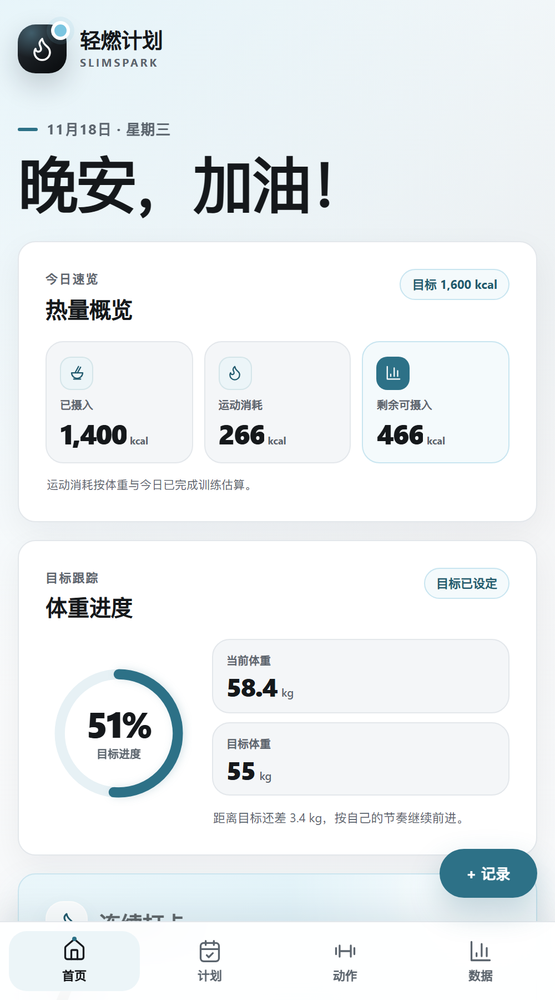
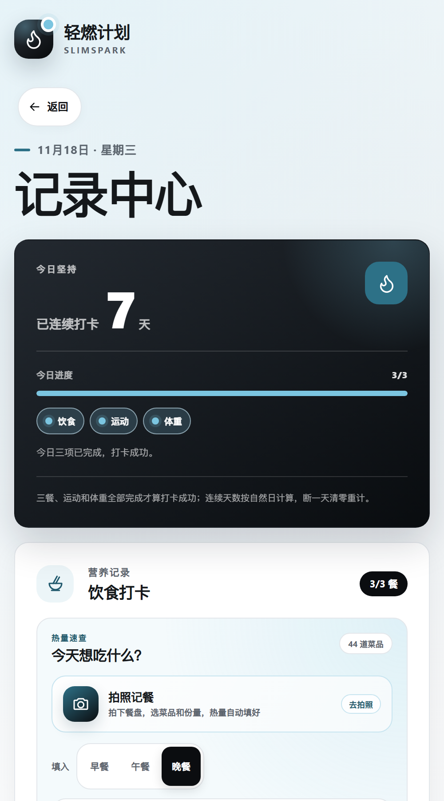
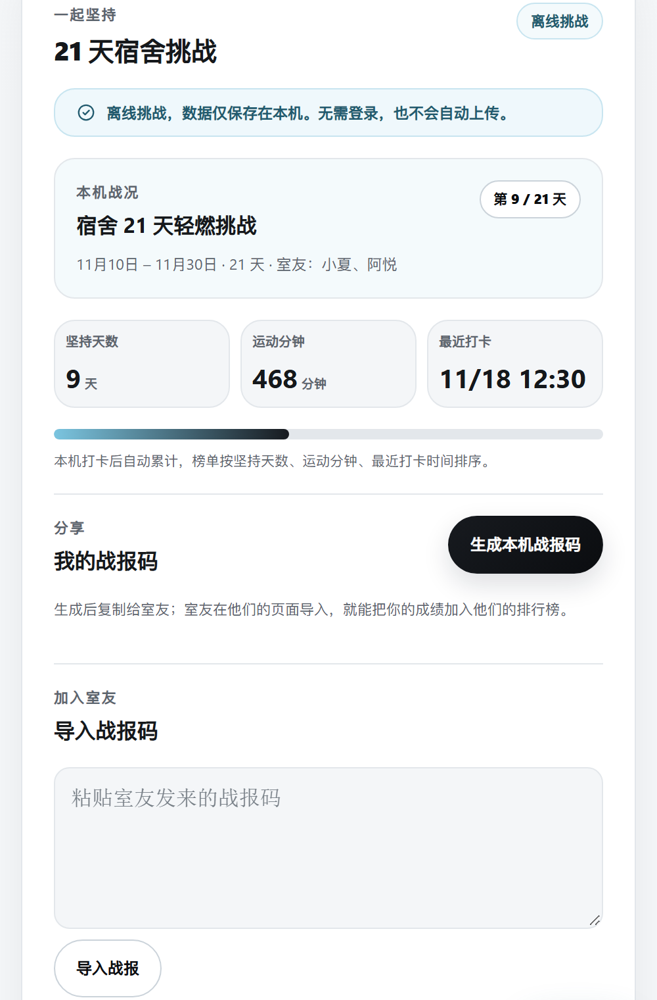
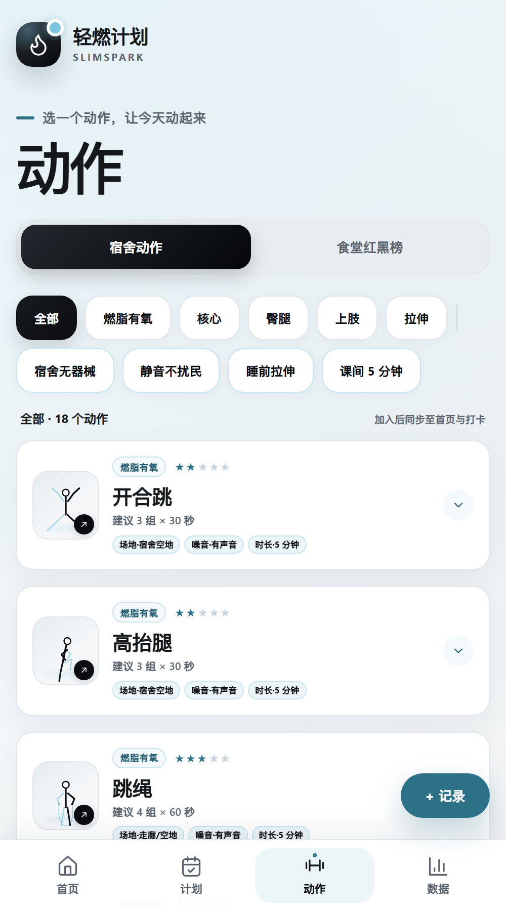

<div align="center">

# 轻燃计划 SlimSpark

**把减重或增重，变成可持续的日常。**

一个本地优先的校园体重管理与健康打卡单页应用。核心记录无需账号、无需上传；AI 拍照识别是可选能力。

[完整在线体验（含 AI）](https://slimspark-3tunwyl4sfw.qoder.zone/) · [GitHub Pages 静态版](https://flow89930-source.github.io/slimspark/) · [English](README.en.md)

[](https://slimspark-3tunwyl4sfw.qoder.zone/)
[](https://flow89930-source.github.io/slimspark/)
[](https://github.com/flow89930-source/slimspark)
[](https://github.com/flow89930-source/slimspark)
[](LICENSE)

</div>

| 首页 | 记录中心 |
|:---:|:---:|
|  |  |

| 数据页：21 天宿舍挑战 | 动作库 |
|:---:|:---:|
|  |  |

## 项目简介

SlimSpark 把目标规划、课表训练、饮食/运动/体重记录、身体围度和挑战回顾放进一个移动优先的界面。

- **本地优先**：没有账号、云同步、统计脚本或广告。身高、体重、饮食、运动和打卡记录默认只保存在当前浏览器的 `localStorage`。
- **双向目标**：同时支持减重和增重。BMI 偏低时，如果仍设置减重目标，应用会提示健康风险并引导开启增重计划。
- **校园场景**：一周课表、课间微运动、宿舍静音训练、食堂点餐参考、开学季也能坚持的轻量训练。
- **可选 AI**：主动点击“AI 识别”时，压缩后的餐盘照片才会发送到服务端；识别失败会回退到本地菜品库，不阻塞手动记录。
- **无构建步骤**：静态页面使用原生 HTML、CSS 和 JavaScript，克隆后即可运行；图表来自 CDN。

> BMI、BMR、TDEE、热量目标和训练建议属于通用估算，不构成医疗建议。如有特殊健康状况，请咨询医生或注册营养师。

## 功能一览

### 计划与课表

- 输入性别、年龄、身高、当前体重、目标体重、每周运动天数和期望周期。
- 自动计算 BMI、基础代谢（BMR）、每日总消耗（TDEE）和建议每日热量。
- 根据目标方向生成 4 / 8 / 12 周计划，并针对过快的减重或增重节奏给出提醒。
- 增重模式提供热量盈余、蛋白质摄入、力量训练建议和一日增重餐示例。
- 标记每天“有课/空闲”和可用时长，生成本周训练、微运动和休息日安排。
- 支持动作替换、顺延补练、本周内重排和跳过；跳过只调整安排，不影响连续打卡。

### 首页与记录

- 今日热量概览：已摄入、运动消耗和剩余可摄入，点击即可进入对应记录。
- 体重目标进度、连续打卡天数和今日任务完成情况。
- 校园微运动：课间 5 分钟和宿舍静音燃脂，完成后自动写入当天运动记录。
- 饮食打卡支持早餐、午餐、晚餐和加餐，可记录食物与热量。
- 运动打卡支持选择动作、记录时长，并允许自定义今日训练项目。
- 体重记录会同步到首页进度和数据页趋势图。
- 完成打卡后有状态反馈与庆祝动画。

### 拍照记餐与可选 AI

- 拍照或选择图片后，本地压缩到最长边 720px、约 80KB 以内再保存，最近 7 天有效。
- 只有点击“AI 识别”时才会把当前压缩照片发送到服务端；普通拍照记录不上传。
- 识别结果会尝试匹配本地菜品库并自动填入；置信度不足时提示手动选择。
- 未配置后端、离线、超时或请求失败时，会显示明确提示并回退到手动搜索，不出现空白页面。

### 饮食、食堂与动作库

- 内置 44 道常见菜品、7 个分类及热量参考，支持名称/别名搜索和每餐快捷项。
- 30 条食堂点餐参考，包含热量、搭配建议和更轻的替换方式。
- 18 个动作，覆盖燃脂有氧、核心、臀腿、上肢和拉伸。
- 动作卡片可展开查看步骤、呼吸提示和常见错误，并可直接加入今日训练。
- 支持宿舍无器械、静音不扰民、睡前拉伸、课间 5 分钟等筛选，以及智能推荐和动作替换。

### 数据、挑战与徽章

- 体重变化折线图，并标记目标体重。
- 最近 12 周打卡热力图，展示完整打卡与有记录的天数。
- 最近 7 天摄入热量与目标热量对比柱状图。
- 身体维度记录：腰围、臀围和大腿围，支持按日期保存与变化折线图。
- 21 天宿舍挑战：填写挑战名、开始日期和最多 4 位室友昵称，本机打卡后自动累计坚持天数与运动分钟。
- 战报码通过 JSON → Base64 生成，可复制给室友导入；排行榜按坚持天数、运动分钟、最近打卡时间排序。非法战报码会提示“格式不对，请重新复制”，不会崩溃。
- 徽章墙包含食堂特种兵、早八抗饿王、静音卷王、课间猎手和 21 天坚持；条件由本地记录实时计算，点击可查看条件与当前进度。
- Chart.js 加载失败时显示文字摘要和空状态操作按钮，而不是空白图表。

### 移动端与无障碍

- 底部 4 个标签等宽排列：首页、计划、动作、数据；记录中心由独立入口打开。
- 卡片圆角 16px、间距按 8 的倍数组织，适配 `safe-area-inset-bottom`。
- 在 375 / 390 / 430px 宽度下无横向滚动，表格在窄屏改为卡片，按钮最小点击尺寸 44px。
- 所有弹窗支持 Esc 关闭，关闭后焦点回到触发按钮；提供跳转主要内容的 skip link 和可见焦点样式。
- 支持 `prefers-reduced-motion`，图片使用内联 SVG / 懒加载策略，首屏不依赖图表脚本执行。

## 技术栈

| 层级 | 方案 |
| --- | --- |
| 界面 | HTML5 + CSS3（自定义属性、Grid、Flexbox、媒体查询） |
| 逻辑 | 原生 JavaScript（ES6） |
| 图表 | Chart.js 4.4.7（jsDelivr CDN，异步加载） |
| 存储 | 浏览器 `localStorage` |
| 动效 | CSS 动画 + Intersection Observer |
| 可选 AI 后端 | Deno + Qoder Sites Functions |
| 服务端数据 | PostgreSQL（使用量限流与识别缓存） |
| 测试 | Node.js 内置 `node:test` |
| 静态托管 | GitHub Pages（`main` 分支根目录） |

静态应用没有前端框架、包管理器或打包步骤。`functions/` 是可选的 AI 服务端代码，不参与 GitHub Pages 静态发布。

## 项目结构

```text
.
├── index.html                  # 单页应用入口与全部页面结构
├── favicon.svg                 # 站点图标
├── css/
│   └── style.css               # 设计系统、响应式布局与动效
├── js/
│   ├── app.js                  # 计划、打卡、图表、挑战与交互逻辑
│   ├── data.js                 # 菜品、食堂参考与动作数据
│   └── motion.js               # 滚动显现与庆祝动画
├── functions/
│   ├── index.ts                # 可选：Qoder Sites Functions 入口
│   └── routes.mjs              # 可选：AI 识别路由、限流与缓存
├── db/
│   └── schema.sql              # 可选：AI 使用量与缓存表
├── tests/
│   └── meal-ai-routes.test.mjs # 可选后端路由测试
├── docs/screenshots/           # README 展示截图
├── LICENSE                     # MIT 许可证
├── README.md                   # 中文说明
└── README.en.md                # English README
```

## 本地运行

建议通过本地静态服务器访问，而不是直接双击 HTML 文件：

```bash
git clone https://github.com/flow89930-source/slimspark.git
cd slimspark

# macOS / Linux
python3 -m http.server 4173

# Windows
py -3 -m http.server 4173
```

然后打开 <http://localhost:4173/>。静态运行不需要安装依赖或执行构建。

本地静态服务器上没有 AI 后端，因此“AI 识别”会回退到手动搜索；完整 AI 体验请使用[在线完整版](https://slimspark-3tunwyl4sfw.qoder.zone/)。

## 可选后端：AI 拍照识别

AI 识别使用火山引擎方舟（豆包视觉模型），密钥只保存在服务端环境变量中，前端永远不接触密钥。

1. 在 Qoder Sites（或兼容的 Deno 运行环境）中部署 `functions/`。
2. 配置服务端 Secret `ARK_API_KEY`，可选配置 `ARK_VISION_MODEL` 指定视觉模型。
3. 在 PostgreSQL 中执行 `db/schema.sql`，创建使用量限流与识别缓存表。
4. 发布后，前端通过同源接口 `/functions/v1/app/api/meal-photo/recognize` 调用。

```bash
# 后端路由测试
node tests/meal-ai-routes.test.mjs
```

- `functions/index.ts` 依赖 Qoder Sites 运行时提供的 `functions/_qoder/backend.mjs`；该生成目录已加入 `.gitignore`，不会提交到仓库。
- `functions/routes.mjs` 不依赖平台专用适配层，可直接用 Node 测试。
- 当前限流策略：每个浏览器每天 10 次、每个 IP 每天 30 次、全局每天 500 次；1 秒内连续请求会触发 3 小时暂停。相同图片的识别结果缓存 6 小时。
- 不要把 `ARK_API_KEY` 写进 HTML、JavaScript、README、提交记录或任何客户端请求。如果密钥曾经出现在代码或公开聊天中，应立即在云平台轮换。

## 部署

### GitHub Pages 静态版

当前静态版通过 GitHub Pages 发布：

- 源码分支：`main`
- 发布目录：仓库根目录 `/`
- 线上地址：<https://flow89930-source.github.io/slimspark/>
- `main` 分支的 `.nojekyll` 用于关闭 Jekyll 处理，保证静态资源原样发布。

每次向 `main` 推送后，GitHub Pages 会自动重新构建。此版本包含完整的本地记录、图表、围度、宿舍挑战和徽章功能，但不包含服务端 AI，识别按钮会回退到手动选择。

### 完整版（含 AI）

完整版部署在 Qoder Sites：

- 线上地址：<https://slimspark-3tunwyl4sfw.qoder.zone/>
- 同一份前端 + `functions/` 服务端函数 + PostgreSQL 限流/缓存表。

### 推送前手动检查

仓库暂未配置 GitHub Actions，推送前可在本地运行：

```bash
node --check js/app.js
node --check js/data.js
node --check js/motion.js
node --check functions/routes.mjs
node tests/meal-ai-routes.test.mjs
```

## 数据与隐私

- 本地记录键包括 `slimspark.profile`、`checkinRecords`、`weeklyPlan`、`bodyMetrics`、`dormChallenge` 等，全部位于当前浏览器。
- 没有账号系统、云同步、第三方统计脚本或广告 SDK。
- 餐盘照片默认只保存在本机，保留最近 7 天；只有点击 AI 识别时才会上传当前压缩照片。
- AI 请求会使用本地随机访客 ID；服务端对 IP 做哈希后仅用于限流，不保存原始 IP。
- 战报码只包含挑战名、昵称、坚持天数、运动分钟和最近打卡时间；不会自动上传，需要用户手动复制发送。
- 清除浏览器站点数据、使用无痕模式或更换设备后，记录不会自动恢复或同步；目前没有完整数据导出/导入功能。

## 已知限制

- GitHub Pages 无法运行服务端函数，因此静态版不提供 AI 识别；完整 AI 仅在 Qoder Sites 版本可用。
- 在 375px 极窄屏下，首页四位数“剩余可摄入”可能被截断；悬浮“记录”按钮在部分滚动位置会遮住卡片右下角内容。这两项已记录，后续版本继续打磨。
- 体重、围度和挑战数据只存在于当前浏览器，不能跨设备同步。
- Chart.js 来自 CDN；离线打开时会显示文字摘要，图表本身不可用。

## 健康提示

体重管理应优先保证安全和可持续性。应用给出的 BMI、BMR、TDEE、热量缺口或盈余、训练建议仅用于一般信息参考，不能替代医生、注册营养师或专业教练的个体化评估。未成年人、孕期或哺乳期人群、存在慢性疾病或进食障碍风险的人群，请在专业指导下使用。

## 贡献

欢迎提交 Issue 和 Pull Request。提交前请至少运行：

```bash
node --check js/app.js
node --check js/data.js
node --check js/motion.js
node --check functions/routes.mjs
node tests/meal-ai-routes.test.mjs
```

请勿在 Issue、截图、代码或提交中粘贴任何 API 密钥、访问令牌或其他敏感信息。

## 许可证

本项目基于 [MIT License](LICENSE) 开源，Copyright (c) 2026 flow89930-source。

## 致谢

- [Chart.js](https://www.chartjs.org/)：数据页图表
- [Qoder Sites](https://qoder.com/)：完整版部署与可选 AI Functions
- [GitHub Pages](https://pages.github.com/)：静态站点托管
- 页面图标与动作分镜均为项目内联 SVG；动作、菜品和食堂数据随项目维护
